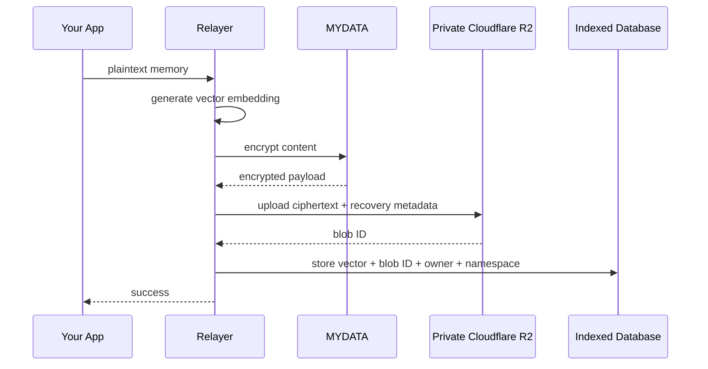
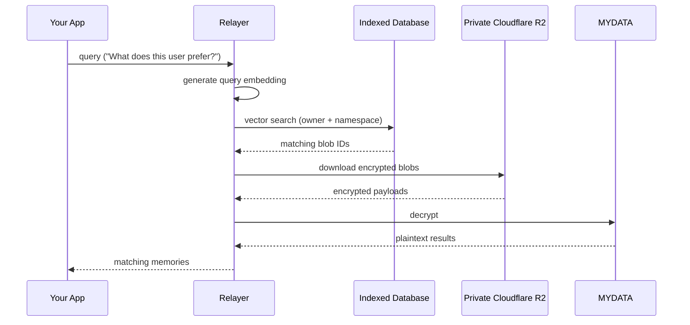
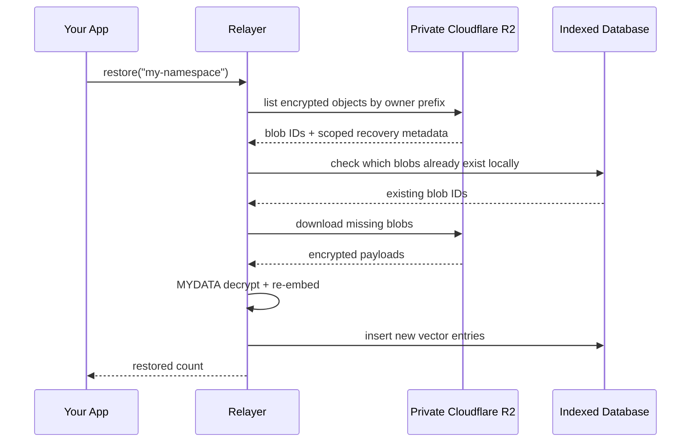

When you call `memory.remember(...)`, your data goes through several steps before it's stored. Here's what happens.

## Storing a memory

<Steps>
  <Step>
    ### Embedding

    The relayer generates a vector embedding from your plaintext content. This embedding is a numerical representation of the meaning of your memory — it's what makes semantic search possible during recall.
  </Step>

  <Step>
    ### Encryption

    The plaintext content is encrypted using MYDATA (MySo's encryption framework). The encrypted payload can only be decrypted by the owner or their authorized delegates.
  </Step>

  <Step>
    ### R2 storage

    The encrypted payload is uploaded to a private Cloudflare R2 bucket. Object metadata records the authenticated agent, encryption package, and visibility scope so the service can rebuild the vector index after database loss. R2 stores ciphertext; plaintext remains outside the bucket.
  </Step>

  <Step>
    ### Vector indexing

    The vector embedding (1536-dimensional, generated by `text-embedding-3-small`), along with the blob ID, owner address, and namespace, is stored in the `vector_entries` table in PostgreSQL with pgvector. An HNSW index on the embedding column enables fast approximate nearest neighbor search during recall.
  </Step>
</Steps>

## Recalling a memory

1. Your query is converted into a vector embedding
2. The database is searched for the closest matching vectors using pgvector's cosine distance operator (`<=>`), scoped to your memory space (`owner + namespace`)
3. Matching encrypted blobs are downloaded from private R2 concurrently
4. Each blob is decrypted via MYDATA using the delegate key
5. Plaintext results are returned to your app, sorted by distance (most relevant first)

<Note>
If an R2 object is missing, the relayer automatically deletes the stale vector entry from the database. This reactive cleanup keeps your recall results clean without manual intervention.
</Note>

## Restoring a memory space

If the local database is lost or incomplete, the restore flow lists the authenticated agent's encrypted objects from the private R2 bucket and rebuilds the vector index.

1. The relayer lists objects under the authenticated owner's private R2 prefix and filters by the authenticated agent metadata
2. It compares against the local database to find which blobs are already indexed
3. Only missing blobs are downloaded, decrypted, re-embedded, and re-indexed
4. The restore supports a configurable `limit` (default: 50) to control how many blobs are processed per call

Restore is incremental and idempotent — you can call it multiple times safely.

## Two layers, one system

| Layer | Stores | Purpose |
|-------|--------|---------|
| **Private Cloudflare R2** | Encrypted blobs and recovery metadata | Durable ciphertext source for the R2-backed relayer |
| **PostgreSQL + pgvector** | Vector embeddings + metadata | Fast semantic search for recall |

The database is rebuildable from R2 objects created with recovery metadata. Legacy File Storage blob IDs are not supported in this R2-only relayer.
